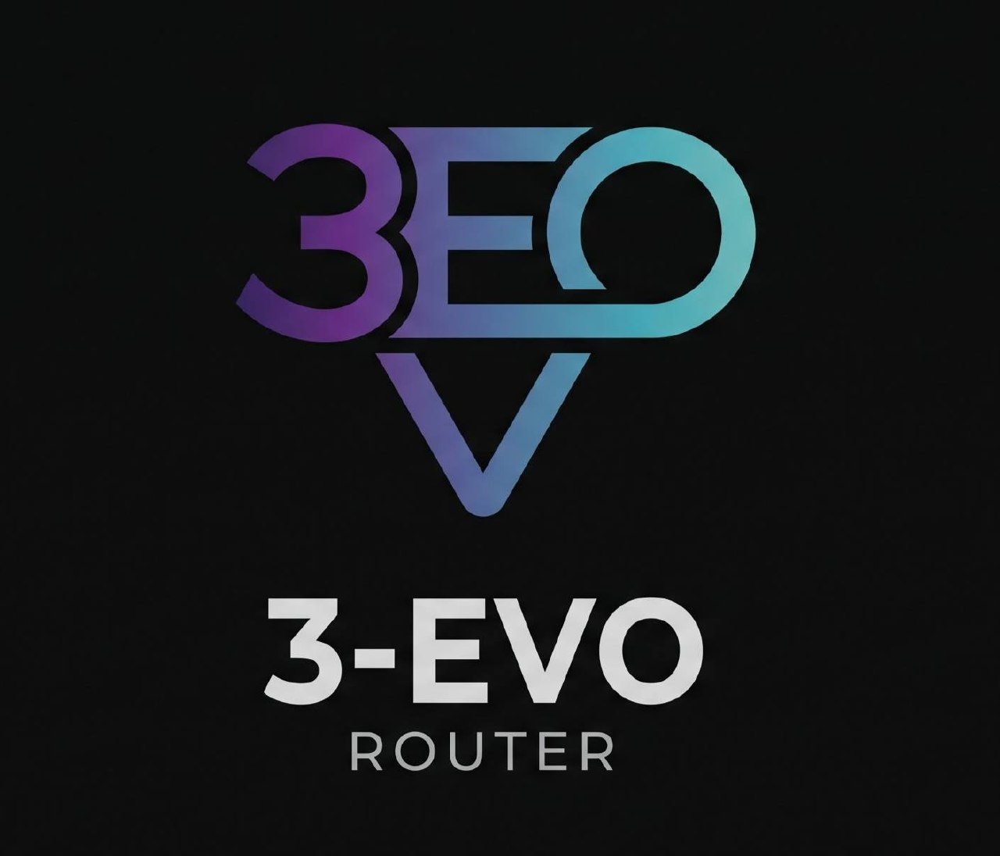

# 3EVO Router — گیت‌وی هوشمند هوش مصنوعی (لوکال + داشبورد تحت وب)

گیت‌وی هوشمند(هوش مصنوعی)( لوکال + داشبورد تحت وب. )یک endpoint واحد و سازگار با OpenAI/Anthropic ارائه می‌دهد و درخواست‌ها را بین چند provider با چرخش چندحسابی، fallback سه‌سطحی و فشرده‌سازی توکن (RTK) به وصورت خودکار و هوشمند مسیریابی می‌کند.



[](LICENSE)

**گیت‌وی هوش مصنوعی لوکال + داشبورد وب.** یک endpoint سازگار با OpenAI/Anthropic ارائه می‌دهد و درخواست‌ها را بین چند provider با چرخش چندحسابی، fallback سه‌سطحی و فشرده‌سازی توکن (RTK) مسیریابی می‌کند.

> متن‌باز (MIT). برای توسعه‌دهندگانی که downtime صفر، هزینه توکن کمتر و بدون نشت اسرار می‌خواهند.

## فهرست
- [ویژگی‌ها](#ویژگیها)
- [معماری](#معماری)
- [امنیت](#امنیت)
- [شروع سریع](#شروع-سریع)
- [پیکربندی](#پیکربندی)
- [اتصال کلاینت‌ها](#اتصال-کلاینتها)
- [ساختار پروژه](#ساختار-پروژه)
- [نقشه راه](#نقشه-راه)
- [مجوز](#مجوز)

## ویژگی‌ها
- **یک endpoint** — OpenAI (`/v1/chat/completions`, `/v1/responses`)، Anthropic (`/v1/messages`)، `/v1/models`.
- **مترجم فرمت جهانی** — OpenAI ↔ Anthropic ↔ Gemini ↔ OpenAI Responses از یک فرمت کانونی.
- **چرخش چندحسابی** — round-robin / priority به ازای هر provider.
- **fallback سه‌سطحی** — اصلی → ارزان → رایگان/اعتبار، با triggerهای per-tier (429/5xx/timeout/401).
- **Circuit breaker** + cooldown + رعایت Retry-After.
- **RTK** — فشرده‌سازی tool_result تکراری؛ اندازه‌گیری واقعی صرفه‌جویی.
- **ردیاب سهمیه** — پنجره ۵ ساعته، محدودیت روزانه/ماهانه، شمارش معکوس reset.
- **استخرهای پروکسی** — HTTP/SOCKS خروجی با health check.
- **ادغام CLI tools** — Claude Code، Cursor، Cline، Codex، OpenClaw (backup + diff + undo).
- **MITM (opt-in)** — فقط لوکال، رضایت صریح، نصب root cert توسط کاربر.
- **i18n** — انگلیسی + فارسی (RTL، Vazirmatn).
- **تم تیره/روشن**، کارت‌های glass، accent emerald.

## معماری
```
Client (OpenAI/Anthropic SDK)
        │
        ▼
  ┌─────────────┐
  │  Gateway    │  /v1/*  (Next.js API routes)
  │  Translator │  (canonical format)
  └──────┬──────┘
         │
   ┌─────┴─────┐
   │  Router   │  combos, tiers, rotation, circuit breaker
   └─────┬─────┘
         │
   ┌─────┴─────────────────────┐
   │ Providers / Accounts      │  OAuth, API-key, compatible
   └─────┬─────────────────────┘
         │
   ┌─────┴─────┐
   │  RTK      │  tool_result compression
   └─────┬─────┘
         │
   ┌─────┴─────┐
   │  Vault    │  AES-256-GCM secrets (SQLite ~/.3evo)
   └───────────┘
```

- ذخیره‌سازی: SQLite (`better-sqlite3`) در `~/.3evo/`.
- اسرار: AES-256-GCM، کلید از OS keychain، fallback scrypt-derived master file (0600).
- CLI: `3evo-router --port 20128 [--daemon] [--no-rtk]`.

## امنیت
- پیش‌فرض bind `127.0.0.1`. اتصال ریموت نیازمند auth.
- `SECRET_PATH` (۱۶-۳۲ کاراکتر) پنل را پشت یک مسیر مخفی قرار می‌دهد.
- Auth داشبورد: argon2/scrypt، کوکی HttpOnly + SameSite=Strict، CSRF، rate limiting.
- اسرار هرگز بعد از ذخیره برگردانده نمی‌شوند (mask شده `sk-…abcd`)، هرگز در logs/errors/usage؛ log scrubber با تست.
- CORS allowlist سخت‌گیرانه؛ SSRF protection روی custom provider URLs.
- دسترسی ریموت فقط از طریق Cloudflare Tunnel / TLS؛ HTTP ساده برای non-localhost رد می‌شود.
- بدون telemetry بالادستی؛ update check اختیاری.
- اعلان یک‌باره ToS درباره استفاده از subscription OAuth.

## شروع سریع
```bash
npm install
cp .env.example .env   # اختیاری
npm run dev
```
پنل: `http://localhost:20128/` (یا `http://localhost:20128/<SECRET_PATH>`)

## پیکربندی
```
PORT=20128
BASE_URL=http://localhost:20128
SECRET_PATH=                # مسیر مخفی ۱۶-۳۲ کاراکتری
DATA_DIR=~/.3evo
CLOUD_URL=                 # endpoint اختیاری sync
SYNC_TIMEOUT_MS=1500
```

## اتصال کلاینت‌ها
```bash
export OPENAI_BASE_URL="http://localhost:20128/v1"
export OPENAI_API_KEY="<router-key-from-dashboard>"
export ANTHROPIC_BASE_URL="http://localhost:20128"
export ANTHROPIC_AUTH_TOKEN="<router-key-from-dashboard>"
```

## ساختار پروژه
```
src/
  app/            # Next.js App Router (dashboard + api)
  lib/            # vault, rtk, combo schema, providers
  cli/            # CLI entry
data/             # providers.json
locales/          # en.json, fa.json
```

## نقشه راه
- [x] Scaffold (Next.js, TS, Tailwind)
- [x] Providers page (interactive)
- [x] Gateway proxy to local model
- [x] Auth (real)
- [x] Anthropic /v1/messages + OpenAI /v1/responses
- [x] Streaming passthrough
- [x] RTK lib + API
- [x] Combo schema (Zod) + combos page
- [x] MITM opt-in consent (stub)
- [x] Usage page + API (SQLite)
- [x] Quota API + page
- [x] Console log (SSE)
- [x] Proxy pools page
- [x] Static showcase docs (index + panel bilingual)
- [x] CLI tools page
- [x] Circuit breaker
- [x] SQLite usage DB
- [x] Translator (OpenAI↔Anthropic)
- [x] Router failover helper
- [x] OAuth start + callback (stub)
- [x] Accounts store (OAuth tokens)
- [x] Settings page + API
- [x] Settings persisted to ~/.3evo/settings.json
- [x] Health endpoint
- [x] Log scrubber + tests
- [x] Vitest (scrubber, rtk)
- [x] Route test endpoint (runWithFallback)
- [x] /v1/chat/completions integrated with runWithFallback
- [x] Gemini format translator
- [ ] OAuth flows (real)
- [ ] Translator (full) + streaming
- [ ] Routing/failover (integrated)
- [ ] Usage + Quota (DB-backed UI)
- [ ] Settings (full)
- [x] Hardening + e2e + docs

## مجوز
MIT — see [LICENSE](LICENSE).
